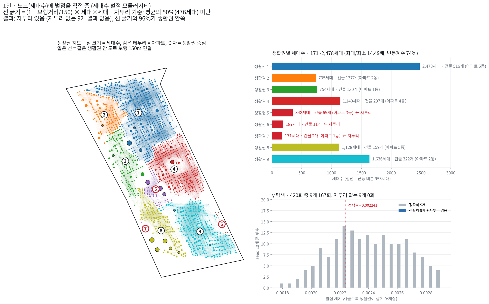
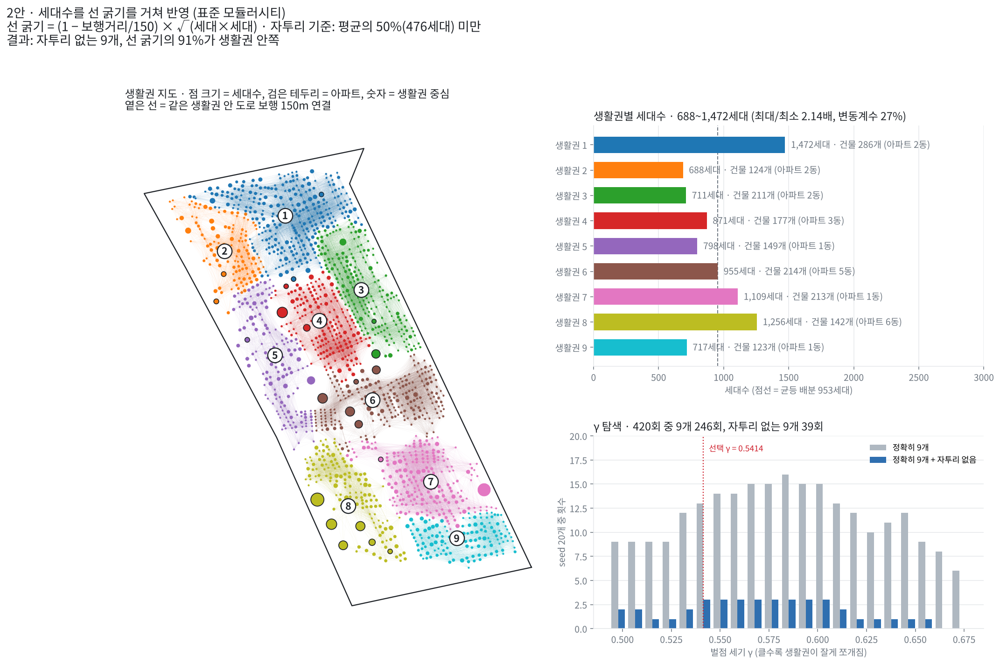

# NetworkX 생활권 나누기: 1안 vs 2안 비교와 선택

두 안 모두 같은 조건에서 비교했다.

- **노드**: 건물 1,639개 (세대수 8,577, 아파트 포함)
- **엣지**: 도로 보행거리 150m 이하인 건물 쌍 54,213개
- **거리 가중치**: 선형 `1 − 보행거리/150`
- **자투리 기준**: 세대수가 평균(953세대)의 **50%(476세대) 미만**인 생활권, 자투리 생활권이 나오지 않아야 함 중요!

---

## 1안. 노드에 직접 벌점을 주는 방식

| 항목 | 내용 |
|---|---|
| 선 굵기 | `선형 × 세대 × 세대` (두 건물의 세대수가 곱해져 연결의 힘이 됨) |
| 벌점 | 세대수 기준 (생활권 세대 총합의 제곱에 비례하는 감점을 직접 부과) |

**문제점**

- 도로 보행거리 150m 안에는 이웃 건물이 그리 많지 않다.
- 그런데 그 좁은 범위 안에 세대수가 폭발적으로 많은 아파트 두세 동이 버티고 있으면, 이 아파트들은 "세대수가 너무 많다"는 이유로 큰 벌점을 받게 된다.

**결과**

- 아파트가 주변 주택가와 섞이면 벌점을 너무 많이 받기 때문에, 차라리 아파트끼리만 떨어져 나와 **2개 동짜리 초미니 생활권**을 만들 수 있게 된다.
- 생활권 안에 세대수가 균형 있게 반영되지 않는다. 171세대짜리(아파트 1~2동) 생활권이 생기고, 반대로 2,478세대짜리 큰 생활권이 생긴다.
- 탐색한 420번 중 정확히 9개가 나온 결과는 있었지만, **자투리 없는 9개 결과는 한 번도 없었다.**

---

## 2안. 표준 모듈러시티 방식 (연결 강도를 거쳐 간접 반영)

| 항목 | 내용 |
|---|---|
| 선 굵기 | `선형 × √(세대 × 세대)` (세대수가 제곱근 형태로 반영되어 선 굵기가 됨) |
| 벌점 | 연결 강도 기준 (연결 강도 안에 세대수의 제곱근 값이 들어 있으므로 벌점에도 간접 반영됨) |

**특징**

- 아파트는 세대수가 많아서 벌점도 크다. 하지만 동시에 다른 건물들과 이어지는 연결 힘(선 굵기)도 그만큼 크다.
- 가산점과 벌점이 같은 기준(연결 강도)으로 함께 커지므로 서로 균형을 이룬다.

**결과**

- 아파트가 혼자 떨어져 나가지 않고, 주변 주택가와 자연스럽게 한 덩어리를 이룬다.
- **자투리 없는 9개 생활권**으로 묶인다 (688 ~ 1,472세대).
- 탐색한 420번 중 자투리가 없는 결과는 39번이었다.

---

## 결과 비교

| | 1안 (노드에 벌점 직접) | 2안 (표준 모듈러시티) |
|---|---|---|
| 생활권별 세대수 | 171 ~ 2,478세대 | 688 ~ 1,472세대 |
| 최대 / 최소 | 14.5배 | **2.1배** |
| 세대수 변동계수 | 74.3% | **27.1%** |
| 자투리 생활권 (476세대 미만) | 3개 | **0개** |
| 가장 작은 생활권 | 건물 2개 (아파트), 171세대 | 건물 124개, 688세대 |
| 정확히 9개가 나온 횟수 (420회 중) | 167회 | 246회 |
| 그중 자투리 없는 횟수 | 0회 | 39회 |
| 거점까지 세대 평균 보행거리 | 170m | **156m** |
| 거점까지 300m 안 세대 | 92.6% | **98.5%** |
| 한 덩어리로 이어진 생활권 | 9 / 9 | 9 / 9 |
| 계산 도구 | NetworkX + leidenalg | NetworkX 내장 Louvain |

거점은 생활권마다 세대 보행거리 합이 가장 작은 건물로 두고, 각 세대가 자기 생활권 거점까지 도로를 따라 걷는 거리를 쟀다.

---

## 선택
> 자투리 기준을 평균의 50%로 설정해도, 1안은 자투리 없는 결과를 한 번도 만들지 못했고, 2안은 자투리 없는 9개 생활권을 만들 수 있었다.
> 아파트만 따로 떨어져 나가는 초미니 생활권이 생기는 것을 막기 위해 **2안, 표준 모듈러시티 방식**을 선택한다.

