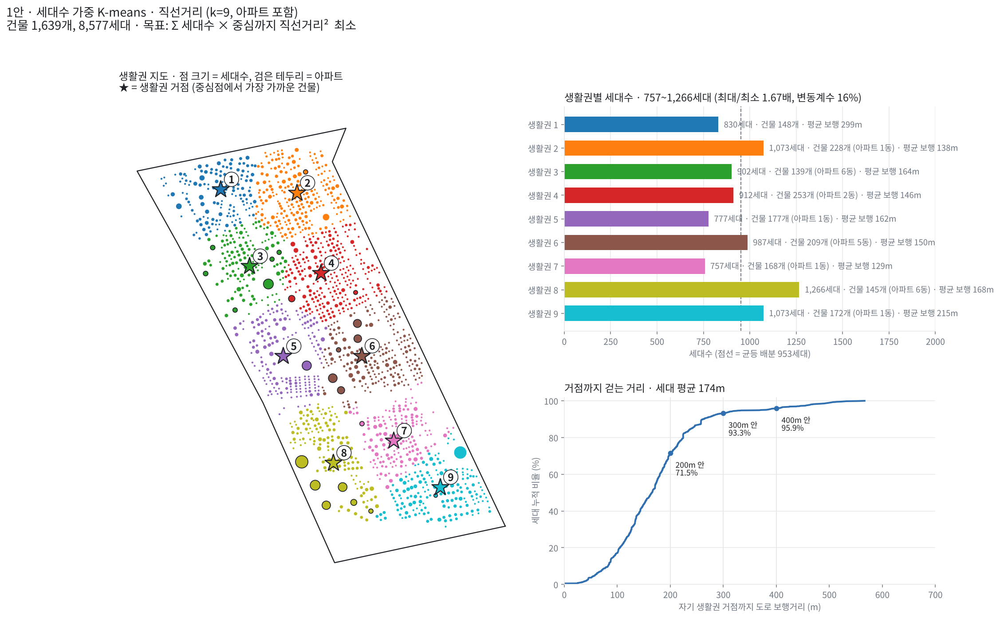
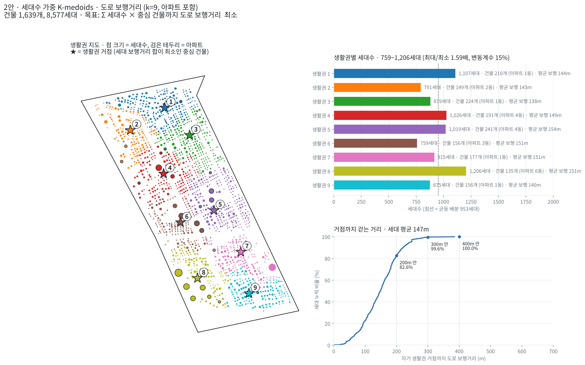

# K-means 생활권 나누기: 1안 직선거리 vs 2안 도로 보행거리 (K-medoids)

신월1동을 세대수 가중치를 준 K-means 계열 방법으로 **생활권 9개**로 나누고, 생활권마다 거점(중심) 1곳을 정한다.
거리를 직선으로 재는 1안과 도로를 따라 걷는 거리로 재는 2안을 비교한다.

## 공통 조건

| 항목 | 내용 |
|---|---|
| 데이터 | `nodes_sinwol1.xlsx` (1차 데이터 정제 결과) |
| 대상 | 건물 1,639개, 8,577세대 (아파트 23동 1,178세대 포함) |
| 생활권 수 | k = 9 |
| 가중치 | 세대수 (세대가 많은 건물일수록 중심을 더 끌어당김) |
| 재현 | 시작점 100번, seed 42 고정 → 누가 돌려도 같은 결과 |

## 1안. 세대수 가중 K-means (직선거리)

| 항목 | 내용 |
|---|---|
| 거리 | 건물 사이 **직선거리** (x, y 좌표, 미터) |
| 중심 | 생활권 세대들의 세대수 가중 평균 위치 (지도 위의 한 점, 건물이 아님) |
| 목표 | `Σ 세대수 × (건물 → 자기 생활권 중심 직선거리)²` 최소 |
| 계산 | scikit-learn `KMeans(sample_weight = 세대수)` |

**로직**

1. 중심점 9개를 놓는다.
2. 모든 건물을 직선으로 가장 가까운 중심점의 생활권에 넣는다.
3. 각 생활권의 중심점을 그 생활권 건물들의 **세대수 가중 평균 위치**로 옮긴다. 세대가 많은 건물 쪽으로 끌려간다.
4. 2~3을 중심점이 더 이상 움직이지 않을 때까지 반복한다.
5. 중심점은 건물이 아니므로, 평가할 때는 **중심점에서 가장 가까운 건물**을 거점으로 본다.

**결과**

- 생활권별 세대수 757 ~ 1,266세대 (최대/최소 1.67배)
- 거점까지 세대 평균 보행거리 174m. 300m 안 93.3%, 400m 안 95.9%
- 생활권 1(북서쪽)은 세대 평균 보행거리가 299m로 길다. 거점까지 직선으로는 평균 85m인데, 이 구역은 도로가 돌아가는 구조라 걸으면 3배 넘게 멀다. 직선으로 묶다 보니 도로로는 멀리 떨어진 건물들이 한 생활권에 들어갔고, 그 안에서 거점을 가장 좋게 골라도 평균 268m이다.

---

## 2안. 세대수 가중 K-medoids (도로 보행거리)

| 항목 | 내용 |
|---|---|
| 거리 | 건물 사이 **도로를 따라 걷는 거리** |
| 중심 | 실제 건물 1개 (medoid). 그 생활권 세대들이 걷는 거리의 합이 가장 작은 건물 |
| 목표 | `Σ 세대수 × (건물 → 자기 생활권 중심 건물 보행거리)` 최소 |
| 계산 | 직접 구현 (scikit-learn에는 세대수 가중 K-medoids가 없음) |

**로직**

1. **모든 건물 쌍의 보행거리 만들기.** 엑셀 `edges` 시트에는 150m 이하 쌍만 있다. 각 보행거리에서 양쪽 건물의 '도로까지 수직거리'를 빼 도로 위 이동거리만 남긴다. 이것을 이어 붙여 최단거리(다익스트라)를 구하고, 출발·도착 건물의 수직거리를 다시 더한다.
2. **시작 중심 고르기.** 이미 고른 중심에서 멀고 세대가 많은 건물일수록 다음 중심으로 뽑힐 확률을 높인다(k-means++ 방식). 100번 반복한다.
3. **배정 ↔ 중심 다시 고르기.** 모든 건물을 보행거리로 가장 가까운 중심 건물의 생활권에 넣는다. 각 생활권 안에서 세대 보행거리 합이 최소인 건물로 중심을 바꾼다. 바뀌지 않을 때까지 반복한다.
4. **중심 교환.** 100번 중 가장 좋은 결과에서 중심을 다른 건물로 하나씩 바꿔 보고, 목표가 줄어들면 바꾼다.

**결과**

- 생활권별 세대수 759 ~ 1,206세대 (최대/최소 1.59배)
- 거점까지 세대 평균 보행거리 147m. 200m 안 82.6%, 300m 안 99.6%, 400m 안 100%
- 가장 먼 세대도 거점까지 384m

---

## 결과 비교

| | 1안 K-means (직선거리) | 2안 K-medoids (도로 보행거리) |
|---|---|---|
| 생활권별 세대수 | 757 ~ 1,266 | 759 ~ 1,206 |
| 최대 / 최소 | 1.67배 | **1.59배** |
| 세대수 변동계수 | 16.3% | **14.6%** |
| 거점까지 세대 평균 보행 | 174m | **147m** |
| 200m 안 세대 | 71.5% | **82.6%** |
| 300m 안 세대 | 93.3% | **99.6%** |
| 400m 안 세대 | 95.9% | **100%** |
| 가장 먼 세대 | 566m | **384m** |
| 거점 | 중심점 근처 건물 (평가용) | 계산으로 정해진 실제 건물 |

**해석**

- 두 방법 모두 세대수 균형은 비슷하다(1.6배 안팎). 세대수 가중 K-means 계열은 세대가 몰린 곳에 중심이 끌려가기 때문에, 생활권별 세대수가 크게 벌어지지 않는다.
- 차이는 **걷는 거리**에서 난다. 2안은 처음부터 도로 보행거리로 거점을 고르기 때문에, 1안보다 평균 27m 짧고 300m 안 세대가 93% → 99.6%로 늘었다.
- 1안은 직선거리로 생활권을 묶기 때문에, 직선으로는 가깝지만 도로로는 돌아가야 하는 건물들이 한 생활권에 들어간다(생활권 1).
- 1안 대비, 보행거리를 고려하면서도 세대 분포가 균등한 k-medoids를 채택하기로 결정.

