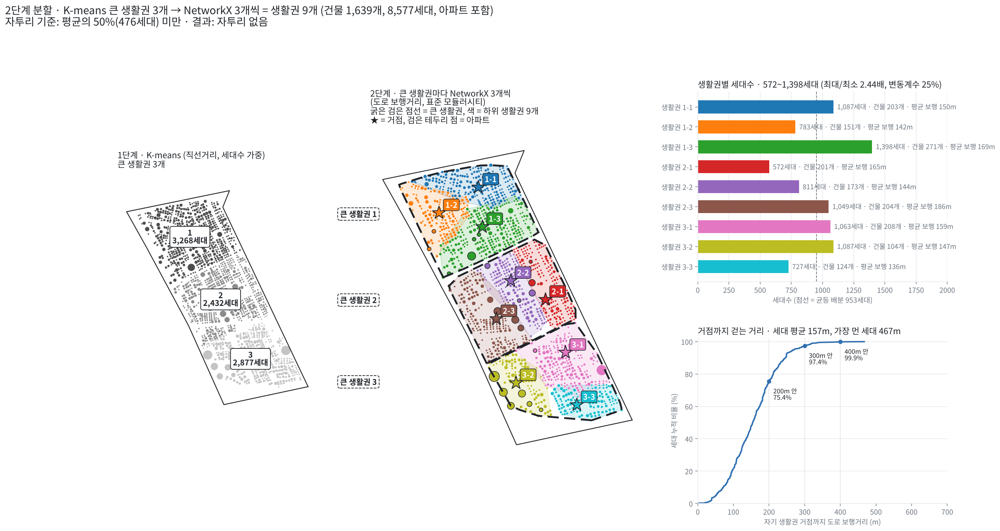

# 2단계 분할 (mix): K-means 큰 생활권 3개 → NetworkX 3개씩 = 생활권 9개

K-means와 NetworkX를 섞어 신월1동을 **생활권 9개**로 나눈다.
먼저 K-means로 큰 틀(큰 생활권 3개)을 세대수 기준으로 고르게 잡는다. 그 다음 그 안을 NetworkX로, 실제 걸어서 이어지는 덩어리를 따라 3개씩 나눈다.

## 공통 조건 (kmeans, network_x 브랜치와 같음)

| 항목 | 내용 |
|---|---|
| 데이터 | `nodes_sinwol1.xlsx` (1차 데이터 정제 결과) |
| 대상 | 건물 1,639개, 8,577세대 (아파트 23동 1,178세대 포함) |
| 생활권 수 | 큰 생활권 3개 × 하위 3개 = 9개 |
| 가중치 | 세대수 (1단계, 2단계 모두) |
| 자투리 기준 | 세대수가 평균(953세대)의 **50%(476세대) 미만**인 생활권 |

## 1단계. K-means로 큰 생활권 3개

| 항목 | 내용 |
|---|---|
| 거리 | 건물 사이 직선거리 (x, y, 미터) |
| 가중치 | 세대수 (`sample_weight`) |
| 목표 | `Σ 세대수 × (건물 → 자기 큰 생활권 중심 직선거리)²` 최소 |
| 설정 | k = 3, 시작점 100번, seed 42 |

**결과** (번호는 북쪽부터)

| 큰 생활권 | 건물 | 세대수 |
|---|---|---|
| 1 (북쪽) | 625개 | 3,268세대 |
| 2 (가운데) | 578개 | 2,432세대 |
| 3 (남쪽) | 436개 | 2,877세대 |

## 2단계. 큰 생활권마다 NetworkX로 3개씩

| 항목 | 내용 |
|---|---|
| 노드 | 그 큰 생활권 안의 건물 (세대수) |
| 엣지 | 도로 보행거리 150m 이하 건물 쌍. **두 건물이 같은 큰 생활권에 있을 때만** 쓴다 → 하위 생활권이 큰 생활권 경계를 넘지 않음 |
| 선 굵기 | `(1 − 보행거리/150) × √(세대ᵢ × 세대ⱼ)` (network_x 2안과 같음) |
| 점수 | 표준 모듈러시티 (벌점 = 연결 강도 기준, 세대수는 선 굵기를 거쳐 간접 반영) |
| 계산 | NetworkX 내장 Louvain (`nx.community.louvain_communities`) |

**결과 고르기 (큰 생활권마다 따로, network_x 브랜치와 같은 규칙)**

1. 벌점 세기 γ를 넓게 훑어, 생활권 수가 3개를 지나는 γ 구간을 찾는다.
2. 그 구간을 21칸으로 나누고 칸마다 seed 20개로 돌린다 (420회).
3. **정확히 3개이면서 자투리(476세대 미만)가 없는** 결과가 가장 많이 나온 γ를 고른다.
4. 그 γ의 결과 중 점수(모듈러시티)가 가장 높은 것을 쓴다.

| 큰 생활권 | 선택 γ | 3개 + 자투리 없음 (420회 중) | 선 굵기 중 하위 생활권 안쪽 비율 |
|---|---|---|---|
| 1 | 0.223 | 228회 | 93% |
| 2 | 0.164 | 115회 | 95% |
| 3 | 0.333 | 202회 | 93% |

---

## 결과

- 왼쪽 지도: 1단계 큰 생활권 3개 (회색 3단계)
- 가운데 지도: 2단계 결과. **굵은 검은 점선 = 큰 생활권 경계, 9가지 색 = 하위 생활권 9개**
- 생활권 이름은 `큰 생활권-하위 번호` (예: 2-1 = 큰 생활권 2의 첫째 하위 생활권)
- ★ 거점 = 생활권마다 세대 보행거리 합이 가장 작은 건물. 거점 이름표 색 = 오른쪽 막대 색

| 생활권 | 건물 | 세대수 | 거점까지 세대 평균 보행 |
|---|---|---|---|
| 1-1 | 203 | 1,087 | 150m |
| 1-2 | 151 | 783 | 142m |
| 1-3 | 271 | 1,398 | 169m |
| 2-1 | 201 | 572 | 165m |
| 2-2 | 173 | 811 | 144m |
| 2-3 | 204 | 1,049 | 186m |
| 3-1 | 208 | 1,063 | 159m |
| 3-2 | 104 | 1,087 | 147m |
| 3-3 | 124 | 727 | 136m |

- 생활권별 세대수 572 ~ 1,398세대 (최대/최소 2.44배, 변동계수 24.7%). 자투리 없음
- 거점까지 세대 평균 보행 157m. 200m 안 75.4%, 300m 안 97.4%, 400m 안 99.9%, 가장 먼 세대 467m
- 9개 모두 도로 보행 150m 연결로 한 덩어리로 이어져 있다

## 다른 방법과 비교

모든 방법의 거점은 생활권마다 세대 보행거리 합이 가장 작은 건물이다. 예외로 K-means(직선)는 중심점에서 가장 가까운 건물을 거점으로 두었다. 보행거리는 모두 같은 방법으로 쟀다.

| 방법 (브랜치) | 생활권별 세대수 | 최대/최소 | 자투리 | 평균 보행 | 300m 안 | 가장 먼 세대 |
|---|---|---|---|---|---|---|
| K-means 직선 (kmeans) | 757 ~ 1,266 | 1.67배 | 0개 | 174m | 93.3% | 566m |
| **K-medoids 도로 보행 (kmeans)** | 759 ~ 1,206 | **1.59배** | 0개 | **147m** | **99.6%** | **384m** |
| NetworkX 1안 (network_x) | 171 ~ 2,478 | 14.49배 | 3개 | 170m | 92.6% | 452m |
| NetworkX 2안 (network_x) | 688 ~ 1,472 | 2.14배 | 0개 | 156m | 98.5% | 400m |
| **2단계 분할 (mix, 이 브랜치)** | 572 ~ 1,398 | 2.44배 | 0개 | 157m | 97.4% | 467m |

**해석**

- **걷는 거리는 좋아졌다.** 2단계에서 도로 보행거리를 반영해, K-means 직선보다 세대 평균 보행이 17m 짧고 300m 안 세대가 93.3% → 97.4%로 늘었다.
- **세대수 균형은 K-means 계열보다 못하다.** 1단계에서 큰 틀은 잡았지만, 2단계 NetworkX가 그 안을 나눌 때 세대수를 맞추지 않는다. 그래서 572세대(2-1) ~ 1,398세대(1-3)로 벌어졌다. NetworkX 2안만 쓴 결과와 비슷한 수준이다.
- **구조적 한계**
  - 1단계 경계가 직선거리로 고정된다. 2단계는 그 경계를 넘을 수 없으므로, 길로는 가까운 건물이 다른 큰 생활권으로 갈릴 수 있다.
  - 큰 생활권마다 "반드시 3개"를 강제한다. 자연스러운 덩어리가 2개나 4개인 곳도 3개로 맞추느라, 큰 생활권마다 γ가 다르다(0.164 ~ 0.333).
- 즉, 세대수 균형과 걷는 거리를 함께 보면 **K-medoids(도로 보행)가 가장 좋다.** mix 할 이유가 없다. 

